# AI Skin Lesion Pre-Screening (Capstone)

**Decision-support prototype only. Not a diagnosis. Consult a qualified clinician.**

An explainable, uncertainty-aware skin lesion pre-screening prototype for places where dermatologists are scarce, starting with Rwanda. You upload or take a photo of a skin lesion and the app returns:

- the most likely lesion class out of 7, with a probability for each class
- an uncertainty level, and a "Review recommended" warning when the model is unsure or sees a possible melanoma
- a heatmap (Grad-CAM) showing which part of the image influenced the result

Every case is saved so it can be looked at again later.

Author: Kayonga Elvis (African Leadership University, BSc Software Engineering, Capstone). Supervisor: Dirac Murairi.

Links:

- GitHub repo: https://github.com/Elvis-Kayonga/ai-skin-lesion-detection-system-capstone-project
- Demo video: https://youtu.be/xynFxpXcZa8 (recorded before the latest changes; an updated video link will replace it)
- Technical report (PDF): [docs/report](docs/report/) (link will point to the final PDF)
- Capstone proposal (PDF): [docs/Capstone_Proposal_Kayonga_Elvis.pdf](docs/Capstone_Proposal_Kayonga_Elvis.pdf)
- Plain-language explanation of the whole project: [MODEL_EXPLANATION.md](MODEL_EXPLANATION.md)

> **Please read the Limitations section before judging the results.** The model learned mostly from light-skinned patients. I fine-tuned it on a small set of dark-skin photos and it improved a lot on a small test, but that test is far too small to prove it works on Black or dark skin. This project does not claim that it does.

---

## Contents

1. [Project status at a glance](#1-project-status-at-a-glance)
2. [What is in this repo](#2-what-is-in-this-repo) (and [2.1 System architecture](#21-system-architecture))
3. [Quick start](#3-quick-start)
4. [How to use the app](#4-how-to-use-the-app)
5. [The model and its results](#5-the-model-and-its-results)
6. [The dark-skin work, step by step](#6-the-dark-skin-work-step-by-step)
7. [Testing and performance](#7-testing-and-performance)
8. [Setbacks and challenges](#8-setbacks-and-challenges)
9. [Screenshots](#9-screenshots)
10. [API summary](#10-api-summary)
11. [Deployment](#11-deployment)
12. [Limitations](#12-limitations)
13. [Future work](#13-future-work)
14. [Notebooks and how to retrain](#14-notebooks-and-how-to-retrain)
15. [Data, licences and credits](#15-data-licences-and-credits)

---

## 1. Project status at a glance

Requirements from my proposal and where they stand:

| ID | Requirement | Status | Where to see it |
|---|---|---|---|
| FR-01 | Upload a lesion image in the web app | Done (upload, drag and drop, camera) | Section 4 |
| FR-02 | Validate format, resolution and size | Done (plus a blur check) | Section 10 |
| FR-03 | Classify into the 7 HAM10000 classes | Done | Section 5 |
| FR-04 | Estimate uncertainty and show it | Done (MC Dropout, Low / Medium / High) | Section 5.3 |
| FR-05 | Grad-CAM heatmap for the top class | Done | Section 9 |
| FR-06 | High uncertainty triggers a review alert | Done | Section 5.3 |
| FR-07 | Case data stored in PostgreSQL | Done, verified with Docker Compose | Section 11 |
| FR-08 | Documented REST API | Done (Swagger UI at `/docs`) | Section 10 |
| FR-09 | Authentication restricts access | Changed: tokens on every API call, but no login screen (anonymous session per browser) | Section 8 |

| Proposal target | Result | Met? |
|---|---|---|
| Balanced accuracy 88 to 93% on HAM10000 | 74.6% (macro recall, deployed model) | No |
| Melanoma false-negative rate below 15% | 6.2% when the review flag counts as a catch | Yes, with the flag |
| Result within 10 seconds | About 1.5 s on a laptop CPU | Yes |
| Usability (SUS) of 65 or more | Study kit ready, but the sessions could not be run before the deadline | Not measured |

## 2. What is in this repo

```
backend/              FastAPI server, model code, database, upload checks
  app/                api/ (routes), services.py, repositories.py, ml/ (model, uncertainty,
                      Grad-CAM, review rule, calibration), quality.py (upload checks)
  model/              deployed model: efficientnet_b3_best.pth + model_config.json
  model/original/     the first model (HAM10000 only), kept as a fallback
  tests/              63 pytest tests
  scripts/            benchmark.py, smoke_test.py, calibrate.py, sus_score.py
frontend/             React web app (Vite), 8 Vitest tests, 8 Playwright end-to-end journeys
notebooks/            training and experiment notebooks (Section 14)
docs/results/         every result file (CSV/JSON) behind the numbers in this README
docs/figures/         charts
docs/screenshots/     screenshots of the running app
docs/usability/       SUS usability test guide and response template
docs/report/          technical report
docs/architecture/    system architecture diagrams (Section 2.1) and their Mermaid sources
deploy/huggingface/   single-container setup for hosting online (prepared, not hosted yet)
docker-compose.yml    PostgreSQL + API + web, production-style setup
MODEL_EXPLANATION.md  plain-language explanation of the whole project
sample_images/        a few HAM10000 images to try the app with
  dark_skin/          29 dark-skin test photos (Fitzpatrick IV-VI) the deployed model never trained on
```

Tech: Python, PyTorch (EfficientNet-B3), Grad-CAM, FastAPI, SQLAlchemy (SQLite for development, PostgreSQL in Docker), React with Vite.

Tested with: Python 3.12.6, Node.js 20.18, PyTorch 2.14.1 (CPU), FastAPI 0.142.2, React 18.3, Vite 5.4, Vitest 2.1.9, Playwright 1.49, Docker Desktop 29.3.1, PostgreSQL 16.15.

### 2.1 System architecture

This is the system as it is actually built. The full set of diagrams, with an explanation of each and the design choices behind them, is in **[docs/architecture/](docs/architecture/README.md)**.

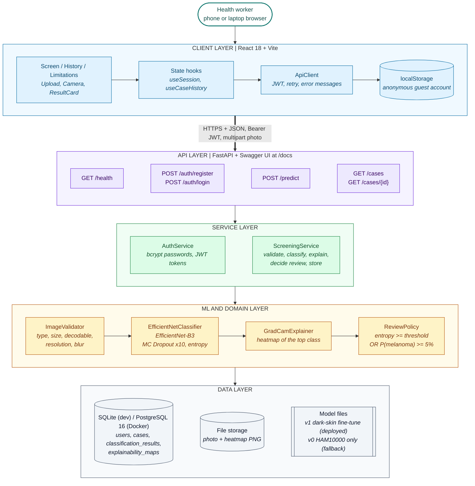

If the diagram does not show (for example in a viewer without Mermaid support), see the [image version](docs/architecture/00_layered_overview.png).

In short:

- **Frontend** (React with Vite): three tabs (Screen, History, Limitations). All network calls go through one `ApiClient`, which adds the access token and keeps an anonymous account in the browser.
- **Backend** (FastAPI): thin routes call `ScreeningService` and `AuthService`. Each job is its own object: `ImageValidator` (5 photo checks), `EfficientNetClassifier` (MC Dropout), `ReviewPolicy` (the review rule), `GradCamExplainer` (heatmap), `ImageStore` (files) and the repositories (database). `AppContainer` builds them once at start-up.
- **Data:** SQLite in development, PostgreSQL 16 in Docker; photos and heatmaps as files; the model loaded once from `backend/model`.

| Diagram | Shows |
|---|---|
| [System overview](docs/architecture/01_system_overview.png) | The parts and how they talk |
| [Screening request](docs/architecture/02_predict_sequence.png) | Every step from "Analyse image" to the result, including rejections |
| [Backend classes](docs/architecture/03_backend_classes.png) | Classes, interfaces and design patterns |
| [Data model](docs/architecture/04_data_model.png) | The 4 database tables |
| [Machine learning pipeline](docs/architecture/05_ml_pipeline.png) | From HAM10000 training to the deployed dark-skin model |
| [Deployment options](docs/architecture/06_deployment.png) | Local, Docker Compose and the single-container setup |

## 3. Quick start

You need Python 3.10 or newer and Node.js 18 or newer. The commands below are for Windows PowerShell. On macOS or Linux use `source .venv/bin/activate` instead of the activate line.

### Step 1: Start the backend

```powershell
cd backend
python -m venv .venv
.venv\Scripts\activate
pip install -r requirements.txt
```

Create your `.env` file (this makes a random secret key for the access tokens):

```powershell
python -c "import secrets; open('.env','w').write('SECRET_KEY='+secrets.token_hex(32)+'\n')"
```

Run the server:

```powershell
uvicorn app.main:app --reload
```

Check it worked: open http://localhost:8000/health. You should see `"model_loaded": true`. The interactive API page (Swagger UI) is at http://localhost:8000/docs.

The server refuses to start without a secret key of at least 32 characters. This is on purpose, so nobody can run it with a guessable key.

### Step 2: Start the web app

Open a second terminal:

```powershell
cd frontend
npm install
npm run dev
```

Open http://localhost:5173 in your browser.

### Optional: run the original (HAM10000-only) model instead

Add these two lines to `backend/.env` and restart the backend:

```
MODEL_DIR=model/original
MODEL_VERSION=efficientnet_b3-v0
```

### Optional: run everything with Docker and PostgreSQL

See Section 11.

### Troubleshooting

| Problem | Fix |
|---|---|
| `SECRET_KEY is missing or too short` | Run the `.env` command in Step 1 from inside the `backend` folder |
| `/health` says `model_loaded: false` | Check that `backend/model/` has `efficientnet_b3_best.pth` and `model_config.json` |
| Web app cannot reach the API | Make sure the backend is running on port 8000 and you opened the web app at `localhost:5173` or `127.0.0.1:5173` |
| Server takes 15 to 20 seconds to start | Normal. It runs one warm-up prediction at start-up so the first real image is fast |

## 4. How to use the app

There is no login screen. Open http://localhost:5173 and you are straight in.

1. Add a photo in one of three ways: click **Take a photo** to use your camera, click **Upload a photo**, or drag and drop a file onto the box.
2. Click **Analyse image**.
3. Read the result card: most likely class, uncertainty meter, probability bars, and the heatmap next to your photo.
4. Try `blurry_example_will_be_rejected.jpg` and `not_an_image_will_be_rejected.txt` from `sample_images/` to see the quality checks reject bad input with a clear message.
5. Open **History** to see past cases, and **Limitations** for the full limitations panel. A short version is also shown on the main screen.

Camera notes: browsers only allow camera access on `localhost` or on an HTTPS site, and you must click Allow when asked. On a phone without in-page camera support, **Take a photo** opens the phone's own camera instead. If the camera is blocked, the app says so and you can upload a photo instead.

Privacy note: with no login, the app quietly creates a private anonymous account in your browser the first time you open it. Your history belongs to that browser only. Clearing your browser data removes the link to your past cases. The server still requires a token for every prediction and history request, so one visitor cannot see another visitor's cases.

The sample images come from HAM10000. Two of them (`ISIC_0031939`, `ISIC_0033609`) were in the **training** set and one (`ISIC_0030440`, a melanoma) was in the **test** set. One image says nothing about accuracy. They are only there so you can try the interface.

To try the app on dark skin, use the photos in `sample_images/dark_skin/`. They are the 29 locked test photos from Phase 4b (Fitzpatrick IV to VI), so the deployed model never trained on them. Each file name gives the true class and skin type, for example `mel_fitz6_4ab4fa98.jpg` is a melanoma on skin type VI. In the running app, 23 of 29 were named correctly and 27 of 28 cancers were named or flagged for review. Details and credits are in [sample_images/dark_skin/README.md](sample_images/dark_skin/README.md).

## 5. The model and its results

All numbers come from real training runs on Google Colab and Kaggle. The files are in `docs/results/` and `backend/model/model_config.json`. Nothing was typed in by hand.

### 5.1 Model versions

| Version | Folder | How it was made | Status |
|---|---|---|---|
| `efficientnet_b3-v0` | `backend/model/original/` | EfficientNet-B3 trained on HAM10000 only (Colab, 14 epochs) | Kept as a fallback |
| `efficientnet_b3-v1-darkskin` | `backend/model/` | v0 fine-tuned with dark-skin photos, benign dark-skin lesions and Fitzpatrick III photos (Phase 4b, Kaggle) | **Deployed** |

Why v1 is deployed even though it broke one of my own rules is explained in Section 6.4.

### 5.2 Results on the HAM10000 test set (1,441 images, never used for training)

HAM10000 has 10,015 dermoscopy images in 7 classes. I split it by lesion, not by image, so the same lesion never appears in two sets.

| Model | Accuracy | Macro precision | Macro recall | Macro F1 | Macro AUC | Melanoma sensitivity |
|---|---|---|---|---|---|---|
| **EfficientNet-B3 v1, dark-skin fine-tune (deployed)** | 80.4% | 0.683 | 0.746 | 0.708 | 0.955 | **70.5%** |
| EfficientNet-B3 v0, HAM10000 only | 83.5% | 0.731 | 0.743 | 0.732 | 0.963 | 57.5% |
| MobileNetV2 (baseline) | 81.0% | 0.650 | 0.722 | 0.673 | 0.954 | 41.8% |

Why macro averages: about 67% of the data is one class (nv, common moles), so plain accuracy looks good even for a weak model. Macro averages treat all 7 classes equally.

The deployed model is slightly worse on overall accuracy and macro F1, but finds clearly more melanomas. For a screening tool that trade is acceptable to me. The per-class table below is for v0 (the per-class breakdown was not exported for v1):

| Class (v0) | Precision | Recall | F1 | Test images |
|---|---|---|---|---|
| akiec (actinic keratoses) | 0.450 | 0.529 | 0.487 | 34 |
| bcc (basal cell carcinoma) | 0.729 | 0.876 | 0.796 | 89 |
| bkl (benign keratosis-like) | 0.772 | 0.566 | 0.653 | 168 |
| df (dermatofibroma) | 0.875 | 0.778 | 0.824 | 9 |
| mel (melanoma) | 0.491 | 0.575 | 0.530 | 146 |
| nv (melanocytic nevi) | 0.930 | 0.925 | 0.927 | 974 |
| vasc (vascular lesions) | 0.870 | 0.952 | 0.909 | 21 |

The df and vasc classes have very few test images (9 and 21), so their scores are unreliable.

### 5.3 Uncertainty and the "Review recommended" flag

The app runs the classifier head 10 times with dropout switched on (MC Dropout) and averages the results. The spread between runs is measured as entropy. An image is flagged for review when entropy is above a threshold chosen on the validation set (0.600 for v1, 0.413 for v0), or when the melanoma probability is at least 5%.

| Measure (HAM10000 test set) | v1 (deployed) | v0 |
|---|---|---|
| Images flagged for review | 38.2% | 31.3% |
| Accuracy on images not flagged | 94.7% | 93.5% |
| Accuracy on images flagged | 56.5% | 61.6% |
| Model mistakes that were flagged | 83.6% | 73.0% |
| Melanoma sensitivity, top class only | 69.9% | 61.0% |
| Melanoma sensitivity, counting a flag as a catch | **93.8%** | 87.7% |

In plain words: the flag works. The model is much more accurate on images it is not worried about, and most of its mistakes are sent for review. With v1, about 1 in 16 melanomas in the test set was neither correctly named nor flagged (1 in 8 with v0). The cost is more referrals: 38% of images instead of 31%.

### 5.4 Calibration experiment (not used by the app)

The v0 model's probabilities are overconfident, so I fitted one "temperature" number (2.017, on the validation set only) to make them honest. Calibration error (ECE) on the test set fell from 0.095 to 0.021, with accuracy unchanged. It also raised the share of flagged images from 31.9% to 35.8%. The code is in `backend/app/ml/calibration.py` and `backend/scripts/calibrate.py`, the numbers in `docs/results/calibration_results.json`. The values are stored in `backend/model/original/model_config.json` and are not wired into the app. They would need to be refitted for v1.

### 5.5 Model design

- **Model:** EfficientNet-B3, pretrained on ImageNet, final layer replaced with 7 outputs, 300 by 300 input.
- **Baseline:** MobileNetV2 with the same training setup.
- **Training (v0):** AdamW optimiser, cosine learning-rate schedule, class-weighted loss, augmentation, early stopping on validation macro F1.
- **Fine-tuning (v1):** started from v0, 6 epochs with small learning rates, each epoch mixing HAM10000 with dark-skin and benign dark-skin images (Section 6).
- **Explainability:** Grad-CAM on the last feature block, for the top predicted class.

Charts:

| | |
|---|---|
| 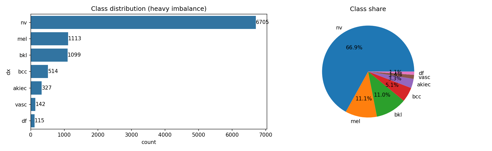 | 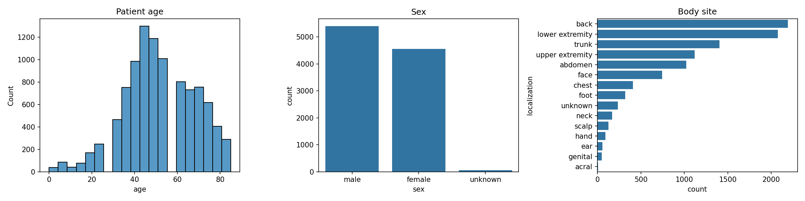 |
| 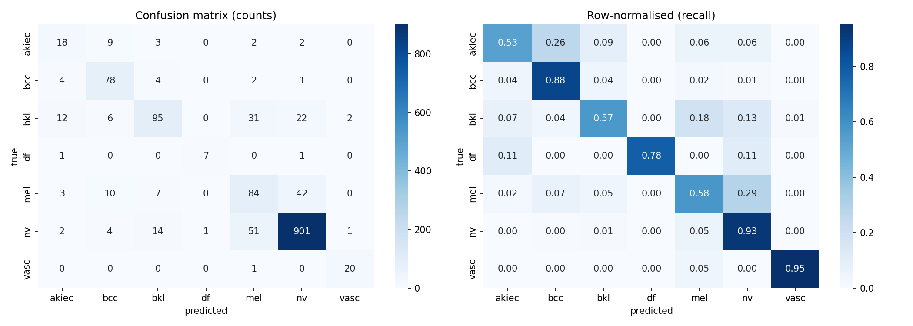 | 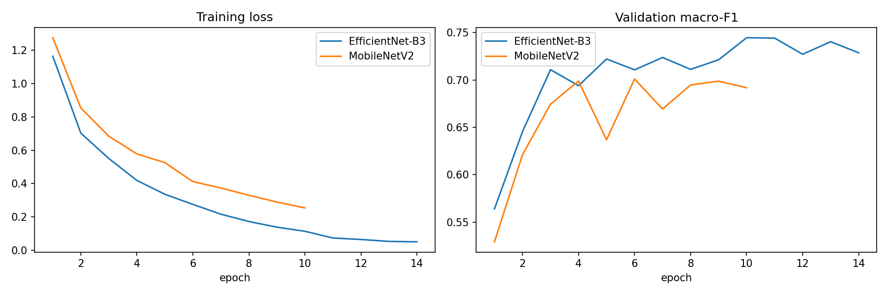 |
| 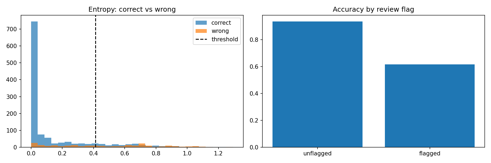 | 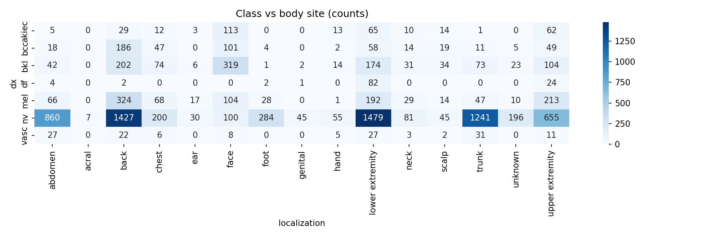 |

The confusion matrix and training curves are for v0. More: `docs/figures/fig_gradcam_examples.png` and `docs/figures/fig_samples.png`.

## 6. The dark-skin work, step by step

My personal goal for this project is that it works fairly for people with Black or dark skin (Fitzpatrick V to VI), who are most of the people in Rwanda. HAM10000 has no skin-tone labels and comes mostly from lighter-skinned patients in Europe and Australia. These are the steps I took, including the ones that failed.

For every experiment I wrote a **promotion rule** before the run, so I could not fool myself after seeing the results.

### 6.1 Measuring the gap (v0)

I tested v0 on two small public dark-skin sets it had never seen:

- 48 labelled Fitzpatrick V-VI photos from Fitzpatrick17k: **27% accuracy**, 6 of 18 melanomas recognised.
- 410 benign Fitzpatrick V-VI lesions from the ISIC Archive (Memorial Sloan Kettering, 21 patients): only 1.7% wrongly called cancer. But 53% were flagged for review, so the model was mostly unsure.

### 6.2 Phase 3: more data of the same kind (failed, not deployed)

Notebook: `notebooks/phase3_finetune_public.ipynb`. I fine-tuned v0 on HAM10000 plus PAD-UFES-20 (2,298 smartphone photos from Brazil, mostly lighter skin). Dark-skin photos were used for testing only.

| Test set | Measure | v0 | Phase 3 model |
|---|---|---|---|
| PAD-UFES-20 phone photos (308) | Accuracy | 34.1% | 80.2% |
| Dark skin, benign (410 lesions) | Wrongly called cancer | 1.7% | **31.2%** |
| Dark skin, labelled (48) | Melanomas recognised | 6 of 18 | **0 of 18** |
| HAM10000 test | Macro F1 | 0.732 | 0.708 |

Phone photos improved a lot, but **dark skin got worse**. Rule failed, not deployed. Lesson: more light-skin data does not help dark skin.

### 6.3 Phase 4, run 1: train on dark skin (failed, not deployed)

Notebook: `notebooks/phase4_finetune_dark_skin.ipynb`. I collected every Fitzpatrick17k photo of skin type IV, V or VI whose diagnosis matches one of my 7 classes. Of 358 candidates, only **139** still downloaded (84 BCC, 40 melanoma, 8 akiec, 4 vasc, 3 df). I measured with 5-fold cross-validation, so every photo was predicted by a model that never trained on it.

| Measure | v0 | Run 1 |
|---|---|---|
| Dark skin IV-VI accuracy (139) | 28.1% | **81.3%** |
| Dark skin V-VI accuracy (48) | 27.1% | **87.5%** |
| Dark-skin melanoma sensitivity | 37.5% | 70.0% |
| HAM10000 test macro F1 | 0.732 | 0.741 |
| Benign dark-skin lesions wrongly called cancer (410) | 1.7% | **38.0%** |

A big gain, with one serious problem. Almost all the dark-skin photos I could get were cancers, so the model learned a shortcut: **"dark skin means cancer"**. Rule failed, not deployed.

### 6.4 Phase 4b: fix the shortcut and tune step by step (deployed as v1)

Notebook: `notebooks/phase4b_tune_dark_skin.ipynb`. Results: `docs/results/phase4b_*`, chart `docs/figures/fig_phase4b_tuning.png`.

1. **Locked test set first.** 20% of the dark-skin photos (29) and half of the benign dark-skin patients (10 patients, 195 lesions) were locked away and used **once**, at the end.
2. **Benign dark-skin lesions in training.** The other 11 patients' benign lesions were added to training. They have no lesion type, only "benign", so I used a loss that pushes probability away from the three cancer and pre-cancer classes.
3. **One change at a time.** A fixed list of changes was tried in order, each judged by cross-validation on the development data only.

| Step | Dark-skin macro F1 (dev) | Benign false alarms (dev) | Kept? |
|---|---|---|---|
| Run-1 recipe (start) | 0.460 | 21.9% | start |
| Add benign dark-skin lesions (15% of each epoch) | 0.485 | 1.4% | kept |
| More benign lesions (30%) | 0.515 | 0.9% | kept |
| More dark-skin photos per epoch (45%) | 0.503 | 1.4% | dropped |
| Longer training (10 epochs) | 0.519 | 0.5% | dropped (gain too small) |
| Class-balanced dark sampling | 0.450 | 1.9% | dropped |
| Label smoothing 0.1 | 0.421 | 1.9% | dropped |
| Add Fitzpatrick III photos (15%) | **0.550** | 1.9% | kept |

The loop reached its 8-hour limit before trying the last two planned changes (freezing early layers, a lower learning rate). The final recipe was then trained once and tested once on the locked sets:

| Locked test (never used for any choice) | v0 | v1 |
|---|---|---|
| Dark skin IV-VI accuracy (29 photos) | 27.6% | **82.8%** (95% CI 69 to 97%) |
| Dark skin IV-VI macro F1 | 0.456 | 0.797 |
| Dark-skin melanomas recognised (11) | 36% | 73% |
| Dark-skin cancers caught or flagged | 92.9% | 100% |
| Dark skin V-VI only, accuracy (11 photos) | 18% | 100% (too few photos to mean much) |
| Benign dark-skin lesions wrongly called cancer (195) | 0.5% | 4.1% (CI 1.6 to 6.5%) |
| HAM10000 test macro F1 | 0.732 | 0.708 |
| HAM10000 melanoma sensitivity | 57.5% | 70.5% |

**The promotion rule failed 2 of its 5 checks:**

- HAM10000 macro F1 dropped by 0.024 (the limit was 0.01).
- False alarms on benign dark skin rose by 3.6 points (the limit was 2).

It passed the other three: melanoma sensitivity on HAM10000 did not drop (it rose), dark-skin accuracy improved, and no extra dark-skin cancers were missed.

**Why I deployed it anyway.** This tool exists for people with dark skin, and for screening, missing cancer is worse than an extra referral. v1 is far better on the dark-skin test, finds more melanomas on both datasets, and the two failed checks were small. I decided this after seeing the results, which is exactly what a pre-written rule is meant to prevent, so I am stating it plainly here. The original model is kept and can be switched back with two settings (Section 3).

**Honest caveats:**

- The locked dark-skin test has only 29 photos, so the confidence intervals are wide.
- The Fitzpatrick17k photos are web-sourced, without patient ids, and may contain label noise.
- My HAM10000 safety check during tuning (macro F1 drop of at most 0.01) was failed by **every** recipe, so the loop ended up choosing on dark-skin results alone.
- The dark-skin data has no common moles or benign keratoses, so the model has never seen those on dark skin with a lesion label.
- The locked test has now been used, so any further tuning needs a new test set.

**None of this shows the model is safe for dark skin.**

## 7. Testing and performance

### 7.1 Automated tests

| Level | What it covers | Result |
|---|---|---|
| Backend unit and integration (pytest, `backend/tests`) | Each upload check, the review rule, password hashing and tokens, services with fake models, calibration maths, SUS scoring, and 18 API tests through the whole app | 63 passed |
| Frontend unit (Vitest) | The API client: tokens, error messages, session recovery and retry | 8 passed |
| End to end (Playwright, `frontend/e2e`) | 8 user journeys in Chromium, Firefox, WebKit, mobile Chrome and mobile Safari | 38 passed, 2 skipped (camera test needs a fake camera, which WebKit does not have) |
| Continuous integration (`.github/workflows/tests.yml`) | All of the above on every push | Linux and Windows |
| Docker smoke test (`backend/scripts/smoke_test.py`) | Health, register, predict, history against the Docker stack with PostgreSQL | Passed |

Run them yourself:

```powershell
cd backend; .venv\Scripts\python -m pytest -q
cd frontend; npx vitest run; npx playwright test
```

### 7.2 Speed and memory

Measured with `backend/scripts/benchmark.py` (full HTTP round trip, including Grad-CAM). Results in `docs/results/performance_*.json`. These were measured with v0. v1 has exactly the same network, so the speed is the same.

| Machine | Start-up | First prediction | Warm median | Throughput, 4 clients | Peak memory |
|---|---|---|---|---|---|
| Laptop, Intel i5-6300U, CPU only | 17.7 s | 1.58 s | 1.52 s | 0.63 req/s | 2,224 MB |
| Kaggle server CPU (Xeon, 4 cores) | 6.6 s | 0.71 s | 0.61 s | 1.58 req/s | 2,956 MB |
| Kaggle NVIDIA T4 GPU | 14.6 s | 0.25 s | 0.17 s | 8.18 req/s | 1,484 MB |

The 10-second target from my proposal is met on every machine. To run the model on a GPU, set `DEVICE=cuda` in `backend/.env`.

### 7.3 Usability

The usability study kit is in `docs/usability/`: tasks, the standard System Usability Scale (SUS) questionnaire, a response template and a scoring script (`backend/scripts/sus_score.py`). Target: mean SUS of 65 or more. Status: I could not run the sessions before the submission deadline, so there is no SUS result and the usability target is not verified. The kit is ready for anyone to run: follow `docs/usability/SUS_test_guide.md`, fill in a copy of the template, then run `python backend/scripts/sus_score.py docs/usability/sus_responses.csv`.

## 8. Setbacks and challenges

Not everything worked the first time. These are the main problems I met, what I did about them, and what I learned.

### 8.1 Model and data

| Setback | What happened | What I did | Result or lesson |
|---|---|---|---|
| Accuracy target missed | My proposal expected 88 to 93% balanced accuracy. I got 74%. | Kept the strict lesion-level split and reported the number as it is | Many published HAM10000 results use image-level splits, where the same lesion can be in training and test. My number is lower but honest. |
| Unbalanced classes | 67% of the photos are common moles | Class-weighted loss, macro scores in every table | Rare but dangerous classes are not ignored |
| Overconfident model | The model often said 100% even when wrong | MC Dropout uncertainty, the review flag, and a calibration test | The review flag catches 84% of mistakes (v1) |
| Melanomas missed | Only 57.5% of melanomas named correctly at first | A low 5% melanoma threshold on the review flag, then the v1 fine-tune | 93.8% caught when the flag counts |
| Phone photos fail | v0 got only 34% on smartphone photos | Phase 3 fine-tune on PAD-UFES-20 reached 80%, but was not deployed because it hurt dark skin | Still an open problem for the deployed model |
| Phase 2 dropped | I prepared a run adding ISIC 2019 (more light-skin dermoscopy) | Dropped it before running once Phase 3 showed more light-skin data made dark skin worse | Saved GPU time for the dark-skin work |
| More data made dark skin worse | Phase 3 raised dark-skin false alarms from 1.7% to 31% | Did not deploy; changed strategy to training on dark-skin photos | The fix for dark skin is dark-skin data |
| "Dark skin means cancer" shortcut | Phase 4 run 1: 38% false alarms on benign dark-skin lesions | Added benign dark-skin lesions with a "not cancer" loss | False alarms fell to 4.1% on the locked test |
| Very little public dark-skin data | Few public datasets have skin-tone labels and lesion types | Searched DDI, Fitzpatrick17k, PAD-UFES-20, ISIC Archive, SCIN, PASSION and synthetic sets | Only Fitzpatrick17k and the ISIC Archive were both usable and downloadable |
| Dead links | Of 358 Fitzpatrick17k dark-skin candidates, only 139 still downloaded, and none of the moles | Used what survived and reported the class mix | The dark-skin training set has no moles, a known weakness |
| DDI dataset not used | I was granted access to the Stanford DDI dataset, but it downloads only through a personal login | Left it for future work to keep the deadline | DDI is the best next test set |
| Tuning took longer than planned | Phase 4b needed about 40 training runs (8.5 hours) | A time limit in the notebook stopped the loop and still produced a final model | 2 of the 9 planned changes were not tried |
| My own safety rule failed | v1 broke 2 of 5 promotion checks | Deployed it with the failure documented, kept v0 as a fallback | Section 6.4 |
| Colab disconnects | Training stopped when Colab disconnected | Checkpoints to Google Drive every epoch, with automatic resume | A disconnect costs at most one epoch |
| No GPU on my laptop | Training would take hours per epoch | Trained on Google Colab and Kaggle (free T4 GPUs) | All training is in notebooks that anyone can rerun |

### 8.2 Software

| Setback | What happened | What I did |
|---|---|---|
| Blur check rejected good photos | My first threshold (60) would have rejected 25 of 43 real dermoscopy photos | Measured sharpness on 43 real photos and set the threshold to 5.0, which still rejects badly blurred ones |
| Badge and banner disagreed | The uncertainty badge could say "Low" next to a "High uncertainty" warning | The API now returns the threshold it used, and the badge uses the same one |
| Old result shown under a new photo | Choosing a new photo left the previous result on screen | The result clears as soon as a new photo is chosen |
| Login screen added friction | For a quick screening prototype with anonymous images, a login step slowed every demo and protected little | Replaced it with an automatic anonymous session per browser, keeping tokens on every API call (FR-09 change) |
| Slow first prediction | The first image took 7.9 s on my laptop because of one-time set-up inside PyTorch | A warm-up prediction at start-up: the first image now takes 1.6 s |
| Docker very slow on first use | Inside Docker on my laptop, the first prediction after a cold start took about 290 s | Documented it. Later predictions take 0.9 to 2.1 s. For a demo, start it early and run one image first |
| CI ran the wrong tests | Vitest tried to run the Playwright files and failed on GitHub | Limited Vitest to `src/**/*.test.js` |
| Benchmark under-reported memory | The first version only measured the launcher process (4 MB) | It now sums memory across the whole process tree |
| Weak secret key risk | The app could run with a default key | The server refuses to start without a 32-character key |
| Demo photos might be training photos | I could not tell which sample images the model had seen | Exported the exact split and checked: two were training images, one a test image. This is stated wherever screenshots appear |

## 9. Screenshots

These are real screenshots of the running app with the deployed model. Two of the three sample images were in the training data, so the screenshots show the interface, not accuracy.

**Home screen: add a photo, with the limitations shown up front**

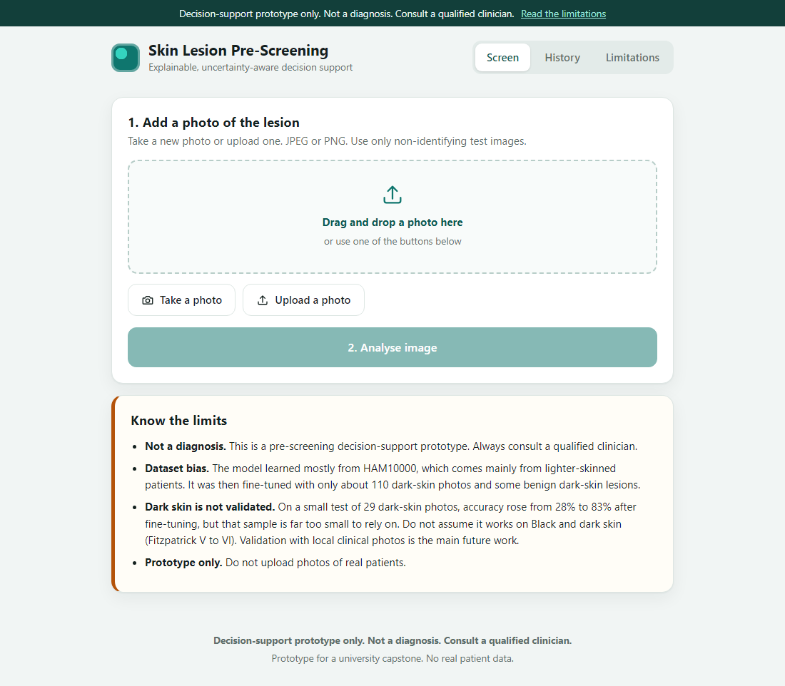

**Take a photo with the camera.** This screenshot was taken with a browser test camera (the green pattern), so it only shows the layout.

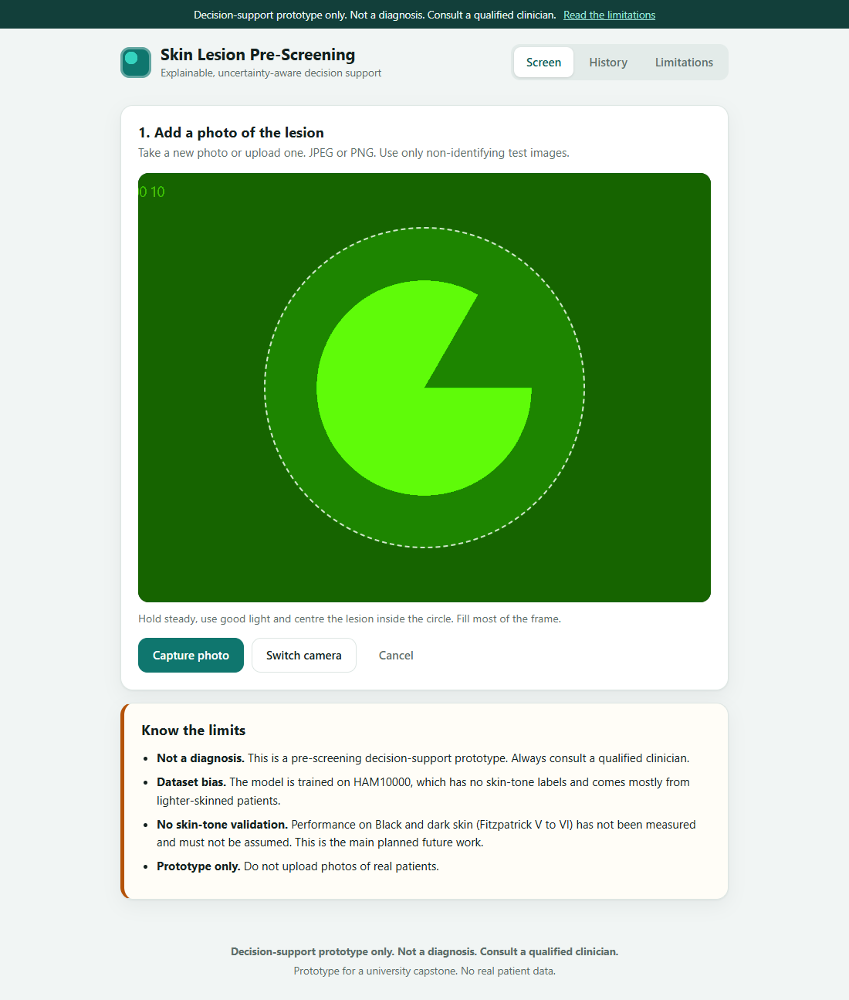

**Upload with preview**

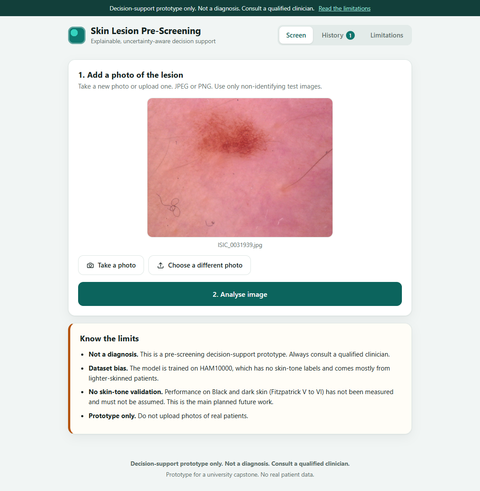

**Results for the three sample images**

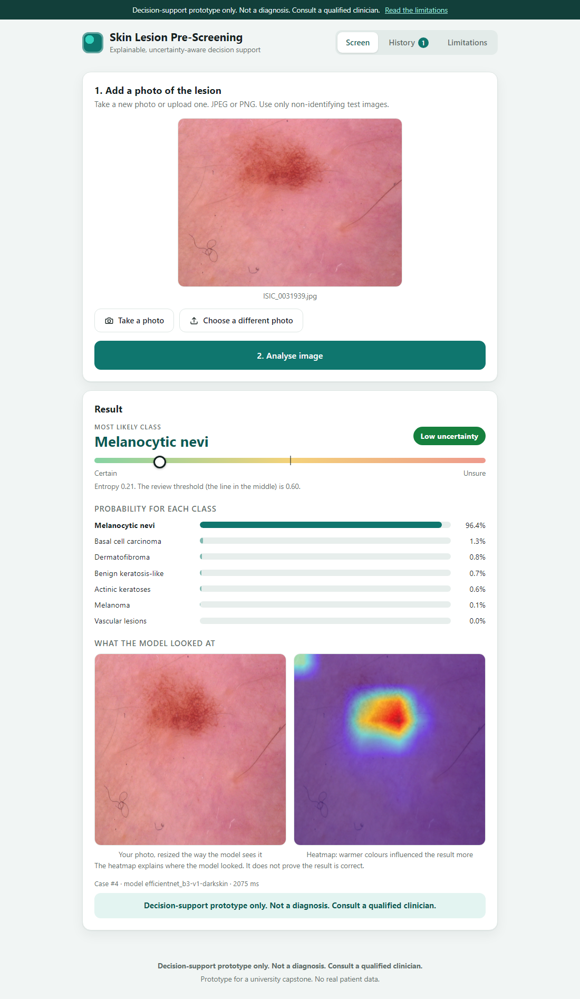

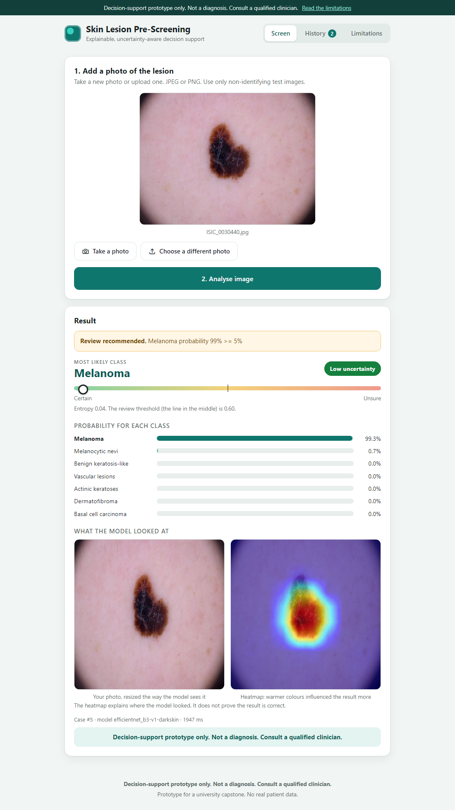

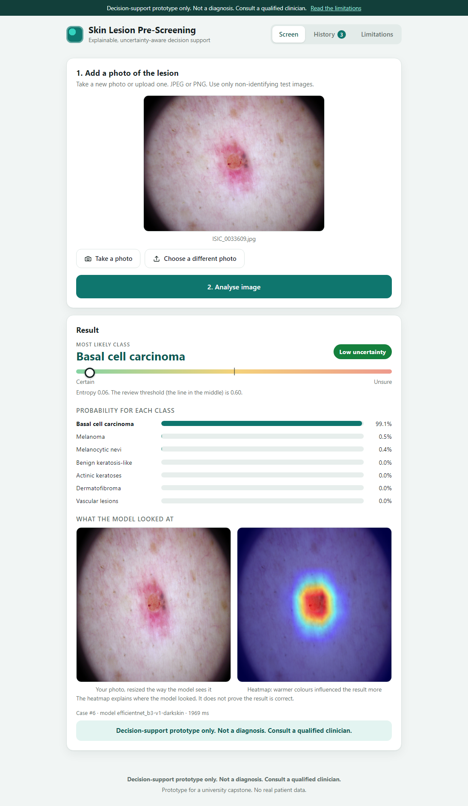

The same image can give slightly different probabilities each time, because MC Dropout is random. Images close to the entropy threshold can flip between flagged and not flagged.

**Quality checks reject bad input**

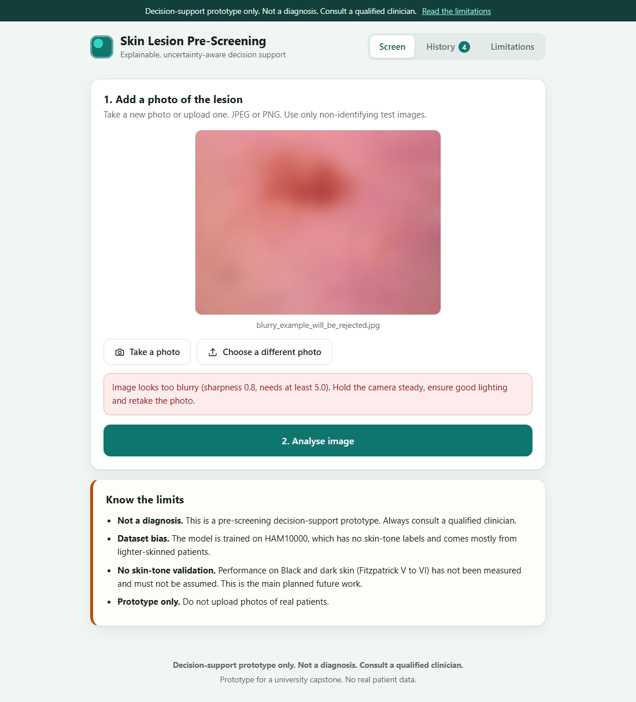
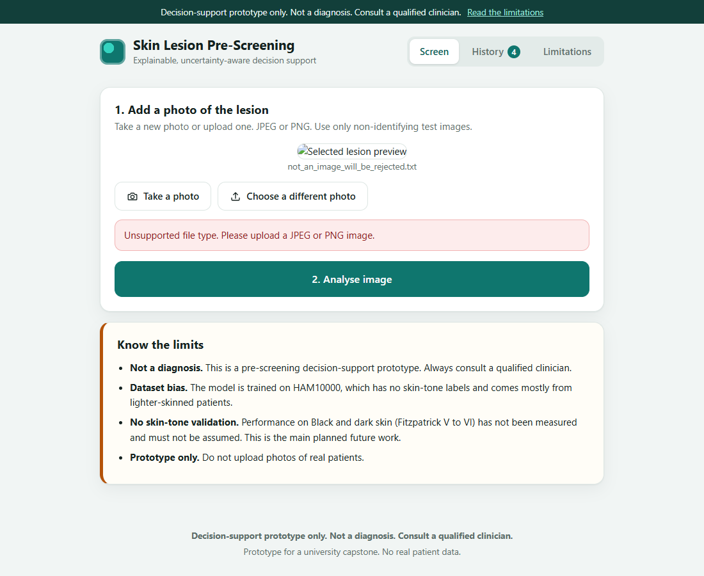

**Case history**

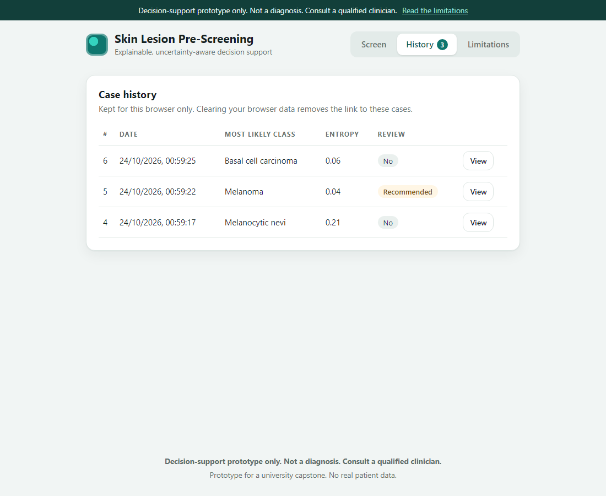

**Limitations panel**

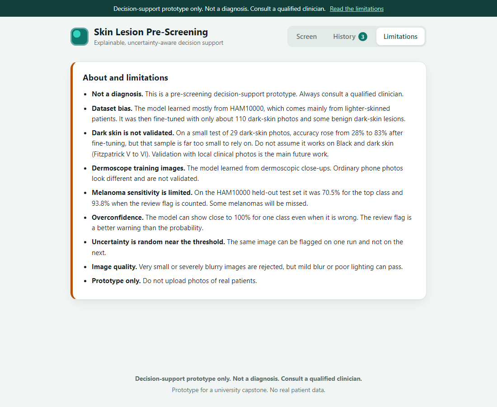

**API page (Swagger UI)**

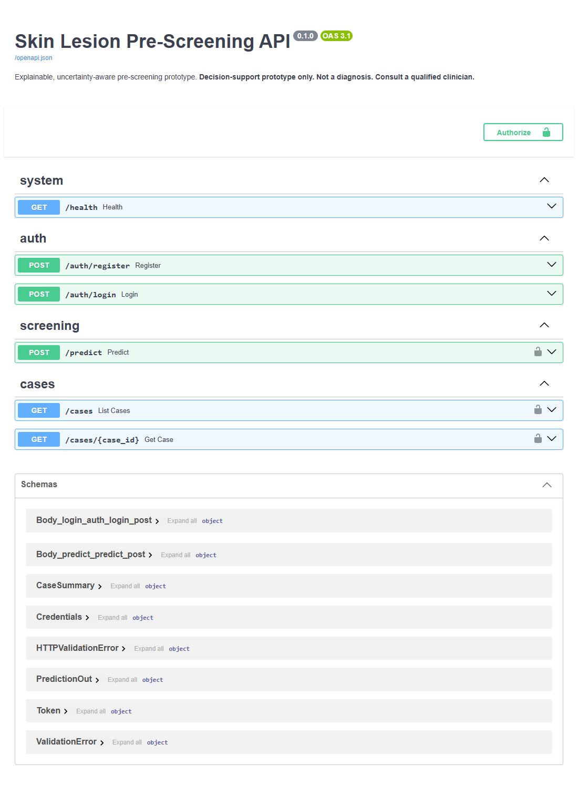

**Phone-width layout**

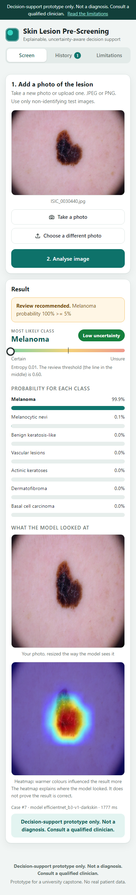

## 10. API summary

Full interactive docs at http://localhost:8000/docs.

| Method and path | What it does | Token needed |
|---|---|---|
| `GET /health` | Server status and whether the model loaded | No |
| `POST /auth/register` | Create an account, returns a token | No |
| `POST /auth/login` | Log in, returns a token | No |
| `POST /predict` | Upload an image (JPEG or PNG), get the prediction | Yes |
| `GET /cases` | List your past cases | Yes |
| `GET /cases/{id}` | Get one past case with its heatmap | Yes |

Upload checks, each with a clear error message: file type (JPEG or PNG only, 415), size (max 8 MB, 413), unreadable image (400), resolution (at least 224 px on each side, 422) and severe blur (422).

Each prediction returns: `case_id`, `predicted_class`, `class_name`, `probabilities` (all 7), `entropy`, `entropy_threshold`, `review_recommended`, `review_reason`, `heatmap_base64`, `model_version`, `disclaimer` and `inference_ms`.

Try it in Swagger UI: open `/docs`, use `/auth/register` to create an account, click **Authorize** and enter the same email and password, then try `/predict`. The web app does all of this for you in the background.

### Code structure (backend)

Diagrams of these classes and of a full request are in [docs/architecture/](docs/architecture/README.md).

- **Routes** (`app/api/routers`) only translate HTTP to service calls.
- **Services** (`app/services.py`): `AuthService` and `ScreeningService` hold the logic: validate, classify, explain, decide review, store.
- **Model layer** (`app/ml`): abstract `LesionClassifier` and `Explainer` interfaces with `EfficientNetClassifier` and `GradCamExplainer`; `ReviewPolicy`; `ModelConfig`.
- **Upload checks** (`app/quality.py`): one `QualityCheck` class per check (Strategy pattern), run by `ImageValidator`.
- **Data** (`app/repositories.py`, `app/storage.py`): repositories over SQLAlchemy, so SQLite and PostgreSQL need no code change.
- **Wiring** (`app/container.py`): `AppContainer` builds everything once at start-up; FastAPI injects it.
- **Errors** (`app/core/errors.py`): domain errors mapped to HTTP codes in one place.

## 11. Deployment

### Local development

SQLite database, run with `uvicorn` and `npm run dev` (Section 3).

### Docker Compose with PostgreSQL (verified)

`docker-compose.yml` runs three containers: PostgreSQL 16, the API, and the web app served by nginx.

```
1. Install Docker Desktop
2. Copy .env.example to .env and fill in SECRET_KEY and POSTGRES_PASSWORD
3. docker compose up --build -d
4. Web app: http://localhost:8080    API docs: http://localhost:8000/docs
5. Check: python backend/scripts/smoke_test.py http://localhost:8000
```

Verified on 23 October 2026: all three containers started, the smoke test registered, predicted and read the history, and PostgreSQL held the cases, results and heatmap records (`docs/results/docker_postgres_check.json`). The first container start and first prediction are slow on a laptop (several minutes). Later predictions take 1 to 2 seconds.

### Steps from prototype to a real pilot

1. **Host:** one small cloud virtual machine in or near the region. A CPU is enough for one image at a time.
2. **HTTPS:** a reverse proxy (for example Caddy or nginx with Let's Encrypt) in front, with `CORS_ORIGINS` and `VITE_API_URL` set to the real domain.
3. **Secrets:** keep `.env` on the server only, never in Git.
4. **Data:** back up the PostgreSQL volume. Delete uploaded images on a schedule unless a clinical protocol requires keeping them.
5. **Privacy and ethics:** ethics approval and patient consent before any use with real patients, following Rwandan data protection law.
6. **Clinical validation:** a supervised study against dermatologists, with results split by skin tone, before any pilot.
7. **Monitoring:** log request counts, errors and the share of images flagged for review. A sudden jump in flags can mean the incoming photos look different from the training data.

## 12. Limitations

Please read these.

1. **Not a diagnosis.** This is decision support for pre-screening. A person with a concerning lesion needs a qualified clinician no matter what this app says.
2. **Dark skin is not validated.** The model improved a lot on a locked test of 29 dark-skin photos, but that sample is tiny, web-sourced, and has no moles. Do not assume it works on Black or dark skin (Fitzpatrick V to VI).
3. **More false alarms on dark skin than before.** v1 wrongly called 4.1% of benign dark-skin lesions cancer (v0: 0.5%).
4. **Some melanomas are still missed.** On the HAM10000 test set, 70.5% are named correctly and 93.8% are caught when the review flag counts. About 1 in 16 is missed.
5. **Dermoscope training images, not phone photos.** Most training images are dermoscopic close-ups. Ordinary phone photos look different and are not validated for the deployed model.
6. **More referrals.** v1 flags 38% of images for review (v0: 31%).
7. **Overconfidence.** A high probability does not mean the answer is correct. The review flag is a better warning than the probability.
8. **The flag is random near the threshold.** The same image can be flagged on one run and not on the next.
9. **Small classes.** Dermatofibroma (9 test images) and vascular lesions (21) have too few examples for reliable scores. Squamous cell carcinoma is not one of the 7 classes.
10. **Blur check is coarse.** It only catches severe blur. A mildly blurry or badly lit photo can pass.
11. **No usability study yet,** and no clinician has tested the tool.
12. **No real patient data.** Do not upload photos of real patients.

## 13. Future work

1. **Local data:** consented, biopsy-confirmed photos from Rwandan clinics with ethics approval (Rwanda National Ethics Committee), including benign lesions and moles, with Fitzpatrick labels.
2. **A proper external test** on the DDI dataset (access already granted), reporting results separately for each skin type.
3. **Phone photos:** add smartphone data (for example PAD-UFES-20) to the dark-skin recipe.
4. **Finish the tuning list** (freezing early layers, lower learning rate) with a new locked test set.
5. **Calibration** refitted for v1 and switched on, and optional self-reported skin type per case so fairness can be monitored.
6. **Usability study** (SUS) with health workers, then a supervised pilot with clinicians.

## 14. Notebooks and how to retrain

| Notebook | What it does | Where it ran |
|---|---|---|
| `skin_lesion_training.ipynb` | Data analysis, trains EfficientNet-B3 (v0) and MobileNetV2, all main metrics and charts | Google Colab, T4 |
| `phase1_export_logits.ipynb` | Exports model outputs for the calibration experiment | Google Colab |
| `phase3_finetune_public.ipynb` | Fine-tune on HAM10000 + PAD-UFES-20, test on phone photos and dark skin | Kaggle, T4 |
| `phase4_finetune_dark_skin.ipynb` | Fine-tune on Fitzpatrick17k dark-skin photos, 5-fold cross-validation | Kaggle, T4 |
| `phase4b_tune_dark_skin.ipynb` | Locked test set, benign dark-skin lesions, step-by-step tuning, produces v1 | Kaggle, T4 (about 8.5 h) |

To retrain v0: open `notebooks/skin_lesion_training.ipynb` in Google Colab with a GPU, run the cells in order and upload your own `kaggle.json` when asked (never commit it). Copy the resulting `efficientnet_b3_best.pth` and `model_config.json` into `backend/model/`.

To reproduce v1: run `notebooks/phase4b_tune_dark_skin.ipynb` on Kaggle with a T4 GPU, internet on and the dataset `kmader/skin-cancer-mnist-ham10000` attached. The candidate is written to `phase4b/model_candidate/`.

The backend follows this contract exactly: resize straight to 300 by 300 with ImageNet normalisation, 10 MC Dropout passes on the classifier head only, and a review flag from entropy or melanoma probability. The thresholds come from `model_config.json`.

## 15. Data, licences and credits

- **HAM10000:** Tschandl P, Rosendahl C, Kittler H. Scientific Data, 2018. CC BY-NC 4.0.
- **Fitzpatrick17k:** Groh M et al., 2021. CC BY-NC-SA 3.0. Images are downloaded from their original sources and never stored in this repo.
- **ISIC Archive dark-skin benign lesions:** Memorial Sloan Kettering Cancer Center, CC BY.
- **PAD-UFES-20:** Pacheco A G C et al., 2020, via ISIC Archive collection 406, CC BY.
- **Sample images** in `sample_images/` are from HAM10000, for trying the interface only.
- **Dark-skin test photos** in `sample_images/dark_skin/` were listed and labelled by Fitzpatrick17k and come from Atlas Dermatologico (atlasdermatologico.com.br). Copyright stays with their owners; source URLs are in `sample_images/dark_skin/labels.csv`. Non-commercial research and education only.
- **Models:** EfficientNet-B3 and MobileNetV2 from torchvision, ImageNet pretrained weights.
- **Heatmaps:** the `pytorch-grad-cam` library.
- **Methods:** MC Dropout (Gal and Ghahramani, 2016), Grad-CAM (Selvaraju et al., 2017), temperature scaling (Guo et al., 2017), SUS (Brooke, 1996).

Because two of the datasets are non-commercial (CC BY-NC), the trained models are for research and education only.
