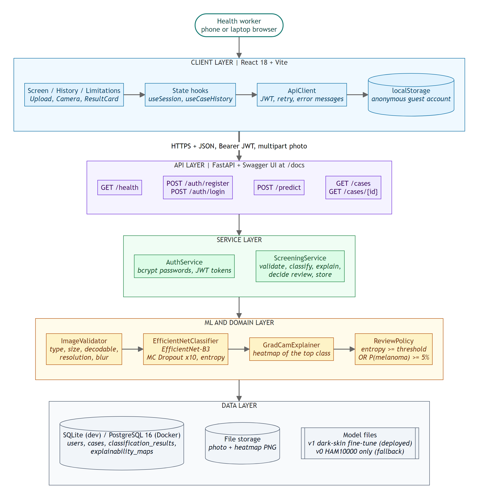
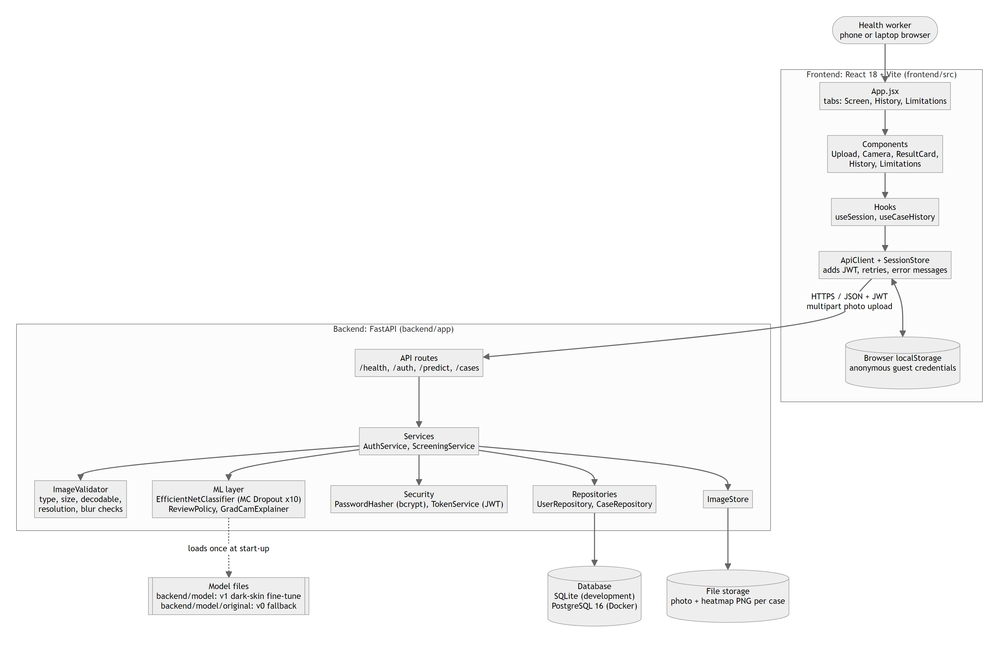
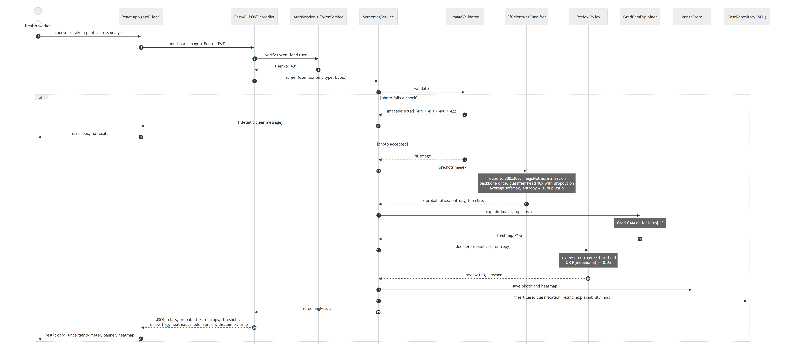
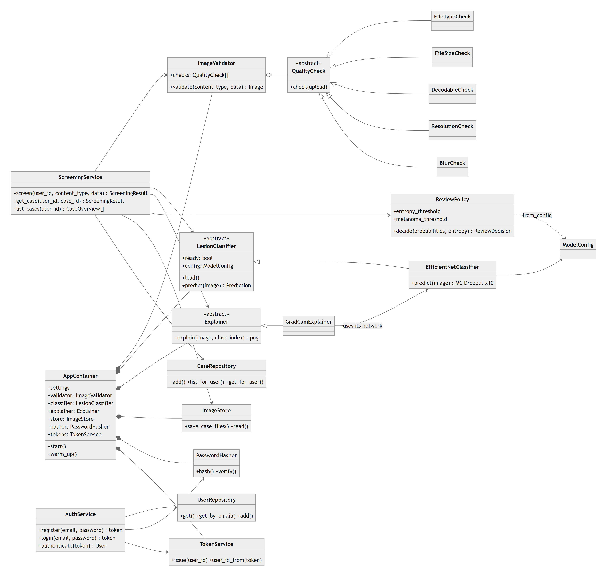
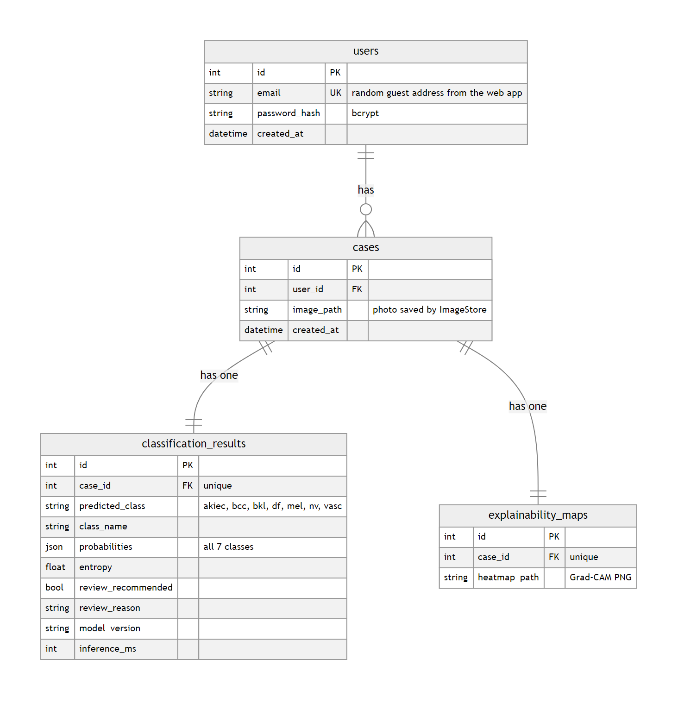
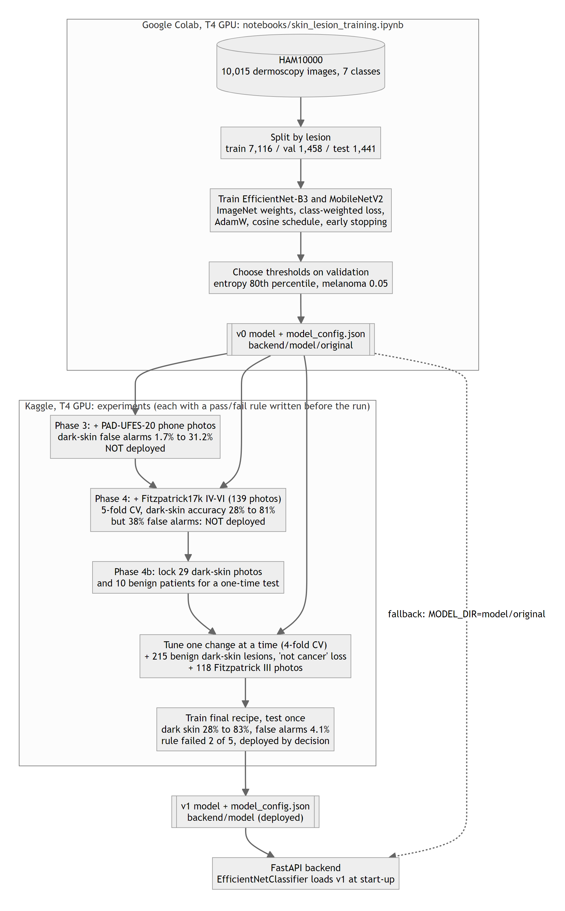
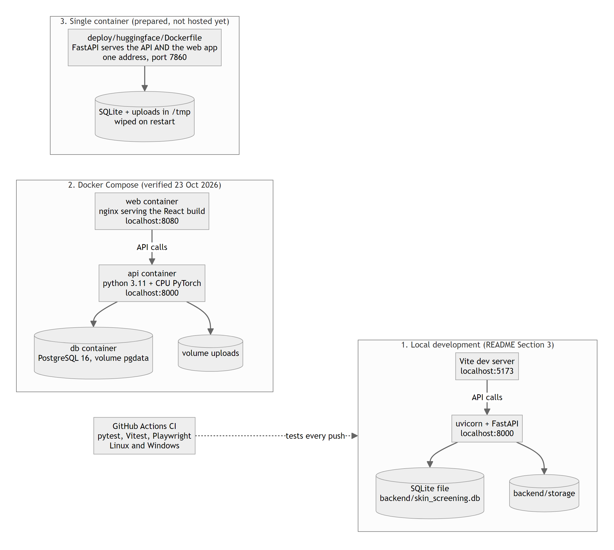

# System architecture

**Decision-support prototype only. Not a diagnosis. Consult a qualified clinician.**

These diagrams show the system **as it is built** in this repository, not as it was planned in the proposal. Every box names a real file, class, table or container. The diagram sources are plain text Mermaid files in [`src/`](src/), so they can be edited and re-rendered.

| # | Diagram | Answers the question |
|---|---|---|
| 0 | [Layered overview](#0-layered-overview) | The whole system in five layers (also shown in the main README) |
| 1 | [System overview](#1-system-overview) | What are the parts and how do they talk to each other? |
| 2 | [Screening request, step by step](#2-screening-request-step-by-step) | What happens when someone presses "Analyse image"? |
| 3 | [Backend classes](#3-backend-classes) | How is the backend code organised? |
| 4 | [Data model](#4-data-model) | What is stored in the database? |
| 5 | [Machine learning pipeline](#5-machine-learning-pipeline) | How was the deployed model produced? |
| 6 | [Deployment options](#6-deployment-options) | Where and how does it run? |

---

## 0. Layered overview

The same system grouped into five layers, from the browser down to the data. Each layer only talks to the one below it. Inside the ML layer, the boxes are in the order `ScreeningService` calls them: check the photo, classify it, draw the heatmap, then apply the review rule. The main README shows this diagram as live Mermaid, which GitHub draws itself.

## 1. System overview

The system has three tiers.

- **Frontend** (`frontend/src`, React 18 with Vite). A single-page app with three tabs. Components only display things; all network work goes through one `ApiClient` object, which adds the access token to every request, retries once if a session has expired, and turns server errors into readable messages. There is no login screen: `SessionStore` keeps a random anonymous account in the browser's `localStorage`, so each browser has its own private history.
- **Backend** (`backend/app`, FastAPI). Thin routes call two services. `ScreeningService` runs one screening; `AuthService` handles accounts and tokens. The services use small, separate objects for each job: photo checks, the model, the review rule, the heatmap, file storage and database access.
- **Data.** The model files are loaded once when the server starts. Case data goes to SQLite during development and to PostgreSQL in Docker. Photos and heatmaps are saved as files, and the database stores their paths.

## 2. Screening request, step by step

1. The browser sends the photo to `POST /predict` with the user's token.
2. The token is checked first. A missing or wrong token stops here with 401.
3. `ImageValidator` runs five checks in order and stops at the first problem: file type (415), size (413), readable image (400), resolution (422) and blur (422). The user sees a clear message and no result.
4. `EfficientNetClassifier` resizes the photo to 300 by 300, runs the network's feature layers once, then runs the final layer 10 times with dropout on (MC Dropout) and averages the results. The spread of those 10 answers gives the entropy, the measure of uncertainty.
5. `GradCamExplainer` draws the heatmap for the most likely class from the last feature block.
6. `ReviewPolicy` decides on review: flag if entropy is at or above the threshold from `model_config.json` (0.600 for the deployed model), **or** if the melanoma probability is at least 5%.
7. `ImageStore` saves the photo and heatmap; `CaseRepository` writes the case, the result and the heatmap path in one transaction.
8. One JSON response goes back: class, all 7 probabilities, entropy and threshold, review flag and reason, heatmap, model version, the disclaimer and the processing time.

## 3. Backend classes

Design choices, and why:

| Choice | Where | Why |
|---|---|---|
| **Composition root** | `AppContainer` (`container.py`) | Builds every long-lived object once at start-up (and runs one warm-up prediction). FastAPI injects them into routes with `Depends`, so nothing is created twice and tests can swap in fakes. |
| **Strategy pattern** for photo checks | `QualityCheck` and its 5 subclasses, run by `ImageValidator` (`quality.py`) | Each rule is one small class. A new rule is one new class, with no change to the others. |
| **Abstract interfaces** for the model | `LesionClassifier`, `Explainer` (`ml/`) | The services depend on the interface, not on PyTorch. Tests use a fake classifier; a different model could be added without touching the API. |
| **Repository pattern** | `UserRepository`, `CaseRepository` (`repositories.py`) | No SQL in the services. This is why moving from SQLite to PostgreSQL needed only a configuration change. |
| **Policy object** | `ReviewPolicy` (`ml/review.py`) | The safety rule lives in one place and reads its thresholds from the model's config, so a new model brings its own thresholds. |
| **Domain errors** | `AppError` and subclasses (`core/errors.py`) | Each error knows its HTTP status. One handler in `main.py` turns them into `{"detail": "..."}`, so every route answers errors the same way. |

## 4. Data model

Four tables, as planned in the proposal's ERD. One user has many cases; each case has exactly one classification result and one heatmap. Probabilities are stored as JSON so all 7 values are kept. `model_version` is stored with every result, so it is always clear which model produced it (`efficientnet_b3-v1-darkskin` or `efficientnet_b3-v0`). Photos themselves are files, not database rows.

## 5. Machine learning pipeline

- **v0** was trained on HAM10000 in Google Colab (`notebooks/skin_lesion_training.ipynb`). It is kept in `backend/model/original` as a fallback.
- Three experiments followed on Kaggle, each with a pass/fail rule written before the run. Phase 3 (phone photos) and Phase 4 run 1 (dark-skin photos) both made something worse and were not deployed.
- **v1** came from Phase 4b (`notebooks/phase4b_tune_dark_skin.ipynb`): a locked test set, benign dark-skin lesions with a "not cancer" loss, Fitzpatrick III photos, and changes tried one at a time. It failed 2 of its 5 rule checks and was deployed by the author's decision, which is documented in the main README (Section 6.4).
- Both versions follow the same contract: 300 by 300 input, ImageNet normalisation, 10 MC Dropout passes, and thresholds stored in `model_config.json`. The backend switches between them with `MODEL_DIR` and `MODEL_VERSION`.

## 6. Deployment options

| Option | Status | Notes |
|---|---|---|
| Local development | Used daily | `uvicorn` on port 8000, Vite on port 5173, SQLite file |
| Docker Compose | Verified 23 October 2026 | nginx web container, API container, PostgreSQL 16 with a data volume. Evidence: `docs/results/docker_postgres_check.json` |
| Single container | Prepared, not hosted | `deploy/huggingface/`: FastAPI also serves the built web app, so one address serves everything. Not hosted because free Docker hosting on Hugging Face now needs a paid plan |

GitHub Actions runs pytest, Vitest and Playwright on every push, on Linux and Windows.

---

## Editing the diagrams

The `.mmd` files in [`src/`](src/) are [Mermaid](https://mermaid.js.org/) diagrams. GitHub shows them as text; the PNG files next to this README are rendered from them. To change a diagram, edit its `.mmd` file and re-render it, for example with the Mermaid Live Editor (https://mermaid.live) or the Mermaid CLI (`npx @mermaid-js/mermaid-cli -i src/01_system_overview.mmd -o 01_system_overview.png`).
